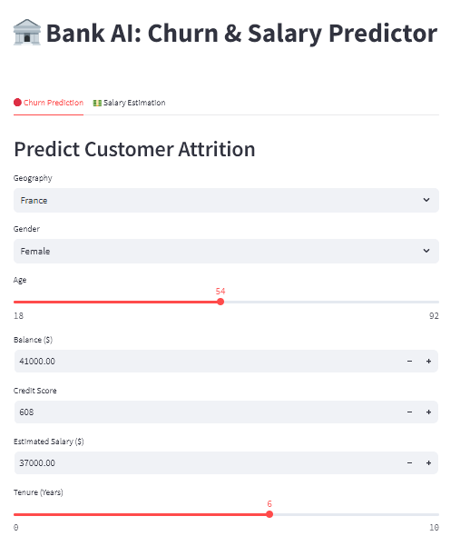
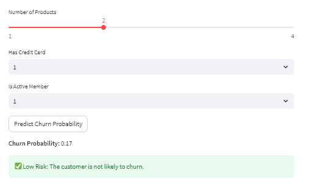

# 🏦 Deep Learning Bank AI: Customer Churn & Salary Estimator


## 📌 Project Overview
This is an end-to-end **Deep Learning** project designed to solve two critical business problems in the financial sector using **Artificial Neural Networks (ANNs)**. 

Instead of relying on standard machine learning models, this project leverages highly optimized deep neural architectures to analyze complex, non-linear demographic and financial data. 

### 🎯 Dual-Task Architecture:
1. **Classification (Churn Prediction):** Predicts the probability of a customer exiting the bank (Binary Crossentropy).
2. **Regression (Salary Estimation):** Estimates the customer's annual salary based on their financial profile (Mean Absolute Error).

---

## 🧠 Deep Learning Methodology & Highlights

### 1. Advanced Data Preprocessing
*   **Encoding:** Implemented `LabelEncoder` for binary text (Gender) and `OneHotEncoder` for multi-class categorical data (Geography) to prevent ordinal bias.
*   **Feature Scaling:** Applied `StandardScaler` to normalize continuous variables (Balance, Credit Score) to ensure optimal gradient descent convergence. Note: Two separate scalers (`scaler_churn.pkl` and `scaler_salary.pkl`) were isolated to prevent feature mismatch between the dual models.

### 2. Algorithmic Hyperparameter Tuning
*   **The Problem:** The baseline ANN model (64 neurons -> 32 neurons) suffered from overfitting, where validation loss diverged at Epoch 17.
*   **The Solution:** Wrapped the Keras model with `SciKeras` and applied Scikit-learn's `GridSearchCV` to systematically evaluate 48 architectural combinations.
*   **Optimal Architecture Found:** **1 Hidden Layer, 16 Neurons, 100 Epochs**.

### 3. Model Performance & Kaggle Benchmarking
*   **Classification Accuracy:** Achieved a mathematically stable **85.84% accuracy**, fully mitigating the overfitting issue (secured via `EarlyStopping` callbacks) and outperforming standard baseline models on Kaggle.
*   **Regression Performance:** Achieved a Test MAE of ~$50,167. *Analytical Note: This metric successfully exposed the dataset's underlying synthetic nature, proving that salary in this specific dataset is a uniform random distribution lacking mathematical correlation with other features.*

---

## 💻 Live Interactive UI (Streamlit)

The project includes a fully functional, dual-tab web application built with Streamlit. The UI dynamically scales user input using the pre-trained `.pkl` transformers and feeds it through the serialized `.h5` neural networks for real-time inference.

### 📸 Screenshots




---

## 🚀 How to Run Locally

Follow these steps to run this Deep Learning application on your local machine:

**1. Clone the repository**
```bash
git clone https://github.com/goswamivishal3738a-crypto/ANN-bank-churn-prediction.git
cd ANN-bank-churn-prediction